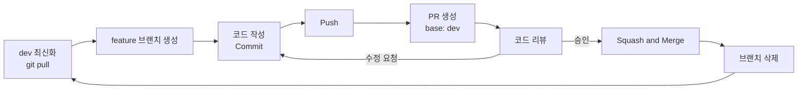
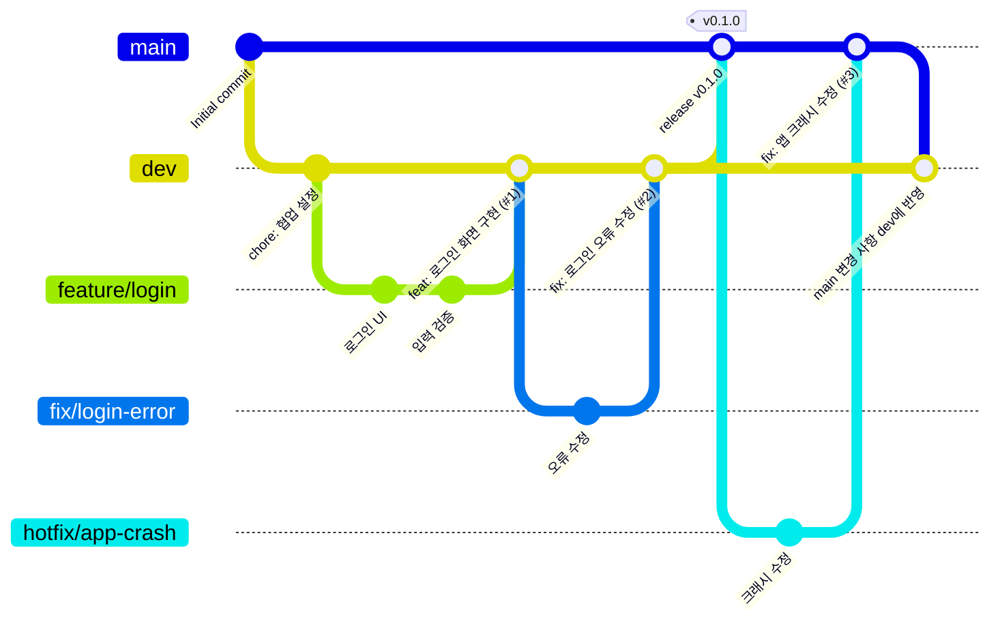

# joaApp

**JOY(죠이) 공동체 구성원의 성경 통독 습관을 돕는 모바일 애플리케이션**
개발 팀 **JOA**의 첫 번째 협업 프로젝트입니다.

> [!NOTE]
> 앱의 **공식 이름은 아직 정해지지 않았습니다.** `joaApp`은 `app.json`에 설정된 임시 이름입니다. 정식 이름이 정해지면 이 제목과 `app.json`의 `name` / `slug`를 함께 변경하세요. (TODO)

## 목차

1. [프로젝트 소개](#1-프로젝트-소개)
2. [기술 스택](#2-기술-스택)
3. [프로젝트 실행 방법](#3-프로젝트-실행-방법)
4. [프로젝트 구조](#4-프로젝트-구조)
5. [GitHub 협업 가이드](#5-github-협업-가이드)
6. [브랜치 전략](#6-브랜치-전략)
7. [Git 초기 설정](#7-git-초기-설정)
8. [팀원 온보딩](#8-팀원-온보딩)
9. [기능 개발 워크플로](#9-기능-개발-워크플로)
10. [Pull Request 및 Merge 방법](#10-pull-request-및-merge-방법)
11. [Commit 컨벤션](#11-commit-컨벤션)
12. [충돌 해결](#12-충돌-해결)
13. [GitHub 저장소 권장 설정](#13-github-저장소-권장-설정)
14. [협업 규칙](#14-협업-규칙)
15. [팀원 및 담당 역할](#15-팀원-및-담당-역할)

더 자세한 규칙, 실수 복구 방법, `git rebase` 같은 고급 내용은 **[CONTRIBUTING.md](./CONTRIBUTING.md)** 에 정리되어 있습니다.

---

## 1. 프로젝트 소개

### 왜 이 프로젝트를 시작했나요?

**JOA**는 구성원 모두가 **동등한 입장에서** AI와 프로그래밍을 공부하고 함께 개발하는 모임입니다.

이 프로젝트는 JOA의 **첫 번째 협업 프로젝트**입니다. 앱을 완성하는 것만이 목표가 아닙니다. 아래 과정을 실제로 경험하고 함께 배우는 것도 같은 무게의 목표입니다.

- GitHub를 이용한 협업 (브랜치, Pull Request, Merge)
- 서로의 코드를 읽고 의견을 나누는 **코드 리뷰**
- 기능 단위의 **역할 분담**
- 기획 → 개발 → 리뷰 → 배포로 이어지는 **실무에 가까운 개발 과정**

그래서 이 README의 절반 이상은 **"어떻게 함께 일하는가"** 에 대한 안내입니다. GitHub 협업이 처음이어도 이 문서를 순서대로 따라오면 참여할 수 있도록 썼습니다.

### 무엇을 만드나요?

**JOY(죠이) 공동체 구성원들이 성경 통독 습관을 만들고 이어갈 수 있도록 돕는 모바일 애플리케이션**을 만듭니다.

| 항목 | 내용 |
| --- | --- |
| 개발 팀 | JOA |
| 대상 사용자 | JOY 공동체 구성원 |
| 핵심 목적 (확정) | 성경 읽기와 **통독 습관 형성** |
| 앱 공식 이름 | TODO (임시 이름: `joaApp`) |
| 개발 기간 | TODO |
| 대상 플랫폼 | TODO — Expo 기본 설정은 Android · iOS · Web |

### 기능

**확정된 것은 "성경 읽기와 통독 습관 형성"이라는 목적뿐입니다.** 이 목적을 어떤 기능으로 이룰지는 팀에서 논의해 정합니다.

아래는 **검토 후보**이며, 아직 구현하거나 확정한 기능이 아닙니다.

| 검토 후보 | 상태 |
| --- | --- |
| 통독 계획 | 💬 논의 예정 |
| 읽기 기록 | 💬 논의 예정 |
| 진행률 표시 | 💬 논의 예정 |
| 알림 | 💬 논의 예정 |
| 공동체 기능 | 💬 논의 예정 |

> 기능이 확정되면 GitHub Issue로 등록하고, 이 표를 "확정 / 개발 중 / 완료" 상태로 갱신합니다.

### 개발 전 확인할 사항: 성경 본문 저작권

성경 본문을 앱에 넣기 전에 반드시 확인해야 합니다. **번역본에 따라 저작권이 있으며, 무료 앱이나 공동체 내부용이라도 사용 허락이 필요할 수 있습니다.** (예: 국내 주요 번역본인 개역개정은 대한성서공회가 저작권을 관리합니다)

- [ ] 사용할 **번역본** 결정 — TODO
- [ ] 해당 번역본의 **저작권자**와 **앱 수록·표시 허락 필요 여부** 확인
- [ ] 본문 **데이터의 출처** (API, 파일 등)와 그 데이터 자체의 **이용 약관·라이선스** 확인
- [ ] 출처 표기 방식, 앱 내 저장(오프라인)·배포 범위에 대한 제한 확인
- [ ] 확인 결과를 문서(Issue 또는 이 README)에 기록

> [!IMPORTANT]
> 위 항목이 확인되기 전에는 성경 본문 전체를 저장소에 Commit하지 마세요. 개발 중에는 짧은 예시 텍스트나 더미 데이터를 사용합니다.

### 현재 상태

`create-expo-app`으로 만든 **기본 템플릿 상태**이며, Home / Explore 두 개의 탭 화면 예제만 들어 있습니다. 백엔드(Supabase)는 사용하기로 정했지만 **아직 프로젝트에 연결하지 않았습니다.**

| 결정 사항 | 상태 |
| --- | --- |
| 프레임워크: Expo + React Native + TypeScript | ✅ 확정, 적용됨 |
| 백엔드: Supabase | ✅ 확정, 미연결 (TODO) |
| 앱 공식 이름 | TODO |
| 세부 기능 | 💬 논의 예정 |
| 성경 번역본 및 본문 출처 | TODO (저작권 확인 필요) |

---

## 2. 기술 스택

`package.json`, `app.json`, `tsconfig.json`에서 확인한 **실제 사용 중인 기술만** 적었습니다.

| 구분 | 기술 | 버전 / 비고 |
| --- | --- | --- |
| 프레임워크 | [Expo](https://docs.expo.dev/) | SDK 58 (`expo ~58.0.23`) |
| 런타임 | React Native | 0.88.1 |
| UI 라이브러리 | React | 19.3.0 |
| 언어 | TypeScript | ~6.0.3, `strict: true` |
| 라우팅 | [Expo Router](https://docs.expo.dev/router/introduction/) | 파일 기반 라우팅, Typed Routes 사용 (`experiments.typedRoutes`) |
| 컴파일러 | React Compiler | `app.json`의 `experiments.reactCompiler: true` |
| 애니메이션 | react-native-reanimated, react-native-worklets | 4.7.1 / 0.13.0 |
| 웹 지원 | react-native-web, react-dom | `web.output: "server"` |
| 기타 Expo 모듈 | expo-image, expo-symbols, expo-glass-effect, `@expo/ui` 등 | 템플릿 기본 포함 |
| 패키지 매니저 | npm | `package-lock.json` 사용 |
| 백엔드 | [Supabase](https://supabase.com/docs) | ✅ 사용 확정 · ⏳ **아직 미설치** (패키지·설정 없음) |
| 협업 도구 | Git, GitHub, VS Code | — |

> [!NOTE]
> - **Supabase 도입은 별도 PR**(예: `feature/supabase-setup`)로 진행합니다. 클라이언트 패키지는 `npx expo install`로 추가하고, 연결 방법은 [Expo – Using Supabase](https://docs.expo.dev/guides/using-supabase/) 가이드를 참고합니다. Supabase 프로젝트를 누가 소유·관리할지, 팀원에게 Dashboard 권한을 어떻게 줄지도 함께 정합니다. (TODO)
> - 상태 관리, 테스트 도구는 **아직 정해지지 않았습니다.** 도입하면 이 표에 추가하세요. (TODO)

---

## 3. 프로젝트 실행 방법

### 필요한 프로그램

| 프로그램 | 확인 명령어 | 비고 |
| --- | --- | --- |
| Git | `git --version` | |
| Node.js (LTS 권장) | `node -v` | Expo SDK 58이 지원하는 Node 버전은 [Expo 문서](https://docs.expo.dev/get-started/set-up-your-environment/)에서 확인 |
| npm | `npm -v` | Node.js 설치 시 함께 설치됨 |
| VS Code | `code --version` | |
| Expo Go 앱 (선택) | — | 휴대폰에서 바로 실행할 때 사용 |

> 참고: 이 저장소를 만든 환경은 Node v26.7.0 / npm 11.19.0 / Git 2.52.0 입니다.

### 실행

```powershell
# 1. 의존성 설치 (package-lock.json 기준)
npm install

# 2. 개발 서버 실행
npx expo start
```

개발 서버가 실행되면 터미널에 QR 코드와 단축키가 표시됩니다.

| 실행 대상 | 방법 |
| --- | --- |
| Android 휴대폰 | Expo Go 앱으로 QR 코드 스캔 |
| iPhone | 기본 카메라 앱으로 QR 코드 스캔 → Expo Go로 열기 |
| Android 에뮬레이터 | 터미널에서 `a` 입력 (Android Studio 에뮬레이터 필요) |
| Web 브라우저 | 터미널에서 `w` 입력 |
| iOS 시뮬레이터 | macOS에서만 가능 (`i` 입력) — Windows 팀원은 실제 iPhone + Expo Go 사용 |

`package.json`에 정의된 스크립트:

| 명령어 | 내용 |
| --- | --- |
| `npm start` | `expo start` |
| `npm run android` | `expo start --android` |
| `npm run ios` | `expo start --ios` |
| `npm run web` | `expo start --web` |
| `npm run lint` | `expo lint` (아래 참고) |
| `npm run reset-project` | 예제 코드를 `example/`로 옮기고 빈 `src/app` 생성 (아래 주의 참고) |
| `npx tsc --noEmit` | TypeScript 타입 검사 (스크립트 미등록, 직접 실행) |

> [!WARNING]
> - **패키지 추가는 `npx expo install <패키지명>`** 으로 합니다. `npm install <패키지명>`은 SDK와 호환되지 않는 버전을 설치할 수 있습니다. 패키지 추가는 팀과 먼저 상의하고, 별도 PR로 올리세요.
> - 휴대폰과 PC가 **같은 Wi-Fi** 에 있어야 QR 실행이 됩니다. 안 되면 `npx expo start --tunnel`을 시도하세요.
> - Expo Go는 자체 포함된 네이티브 모듈만 실행할 수 있고, **스토어의 Expo Go가 프로젝트 SDK(58)를 지원해야** 합니다. 지원하지 않거나 네이티브 라이브러리를 추가했다면 [development build](https://docs.expo.dev/develop/development-builds/introduction/)가 필요합니다.
> - `npm run lint`는 ESLint가 아직 설정되지 않아 **처음 실행 시 ESLint 설치·설정 파일 생성**을 진행합니다. 이것은 프로젝트 설정 변경이므로 한 사람이 `chore/eslint-setup` 같은 브랜치에서 진행하고 PR로 올리세요. (TODO)
> - `npx tsc --noEmit`은 현재(2026-11-06) **템플릿 코드에서 오류 3개**가 발생합니다: `animated-icon.module.css`·`@/global.css` 타입 선언 없음, `app-tabs.web.tsx`의 `ref` 타입 불일치. CSS 관련 오류는 `npx expo start` 실행 시 생성되는 `expo-env.d.ts`가 없어서일 수 있습니다. 정리는 별도 PR로 진행하세요. (TODO)
> - `npm run reset-project`는 `src/`, `scripts/`, 예제 이미지를 옮깁니다. 그런데 `example/` 폴더는 `.gitignore`에 등록되어 있어 **옮겨진 예제 코드는 Git에 올라가지 않습니다.** 팀에서 합의한 뒤 **한 명만** 별도 PR로 실행하세요.

### Windows에서 자주 겪는 문제

| 증상 | 해결 |
| --- | --- |
| PowerShell에서 `npx` 실행 시 "이 시스템에서 스크립트를 실행할 수 없으므로…" 오류 | `Set-ExecutionPolicy -Scope CurrentUser -ExecutionPolicy RemoteSigned` 실행 후 터미널 재시작 (또는 `npx.cmd expo start`) |
| OneDrive 폴더 안에서 `npm install`이 느리거나 파일 잠김 오류 | 프로젝트를 OneDrive 밖(예: `C:\dev`)에 Clone |
| Android 빌드 시 경로 관련 오류 | 한글·공백이 없는 경로(예: `C:\dev\joaApp`)에서 작업 |
| `git status`에서 한글 파일명이 `\354\275...`처럼 보임 | `git config --global core.quotepath false` |

---

## 4. 프로젝트 구조

```text
joaApp/
├── .github/
│   └── pull_request_template.md   # PR 작성 템플릿 (PR 생성 시 자동 적용)
├── .vscode/
│   ├── extensions.json            # 추천 확장: Expo Tools
│   └── settings.json              # 저장 시 자동 수정·import 정리
├── assets/
│   ├── expo.icon/                 # iOS 앱 아이콘
│   └── images/                    # 앱 아이콘, 스플래시, 탭 아이콘, 예제 이미지
├── scripts/
│   └── reset-project.js           # npm run reset-project 스크립트
├── src/
│   ├── app/                       # ⭐ Expo Router 라우트 (파일 1개 = 화면 1개)
│   │   ├── _layout.tsx            # 루트 레이아웃: 테마, 스플래시, 탭 구성
│   │   ├── index.tsx              # Home 탭 화면
│   │   └── explore.tsx            # Explore 탭 화면
│   ├── components/                # 재사용 컴포넌트 (*.web.tsx = 웹 전용 구현)
│   │   └── ui/
│   ├── constants/
│   │   └── theme.ts               # 색상 등 테마 상수
│   ├── hooks/                     # 커스텀 훅 (color scheme, theme)
│   └── global.css
├── AGENTS.md                      # AI 코딩 도우미용 프로젝트 지침
├── CONTRIBUTING.md                # 상세 협업 규칙
├── LICENSE
├── app.json                       # Expo 앱 설정
├── package.json / package-lock.json
└── tsconfig.json                  # 경로 별칭: @/* → src/*, @/assets/* → assets/*
```

**구조 규칙**

- `src/app/` 안의 모든 파일은 화면(라우트)이 됩니다. **컴포넌트·훅·유틸은 `src/app/` 밖**(`src/components`, `src/hooks` 등)에 둡니다.
- import는 경로 별칭을 사용합니다: `import AppTabs from '@/components/app-tabs';`
- `ios/`, `android/` 폴더는 필요할 때 자동 생성되며(Continuous Native Generation) `.gitignore`에 등록되어 있습니다. **직접 만들거나 수정하지 않습니다.** 네이티브 설정은 `app.json`에서 합니다.

---

## 5. GitHub 협업 가이드

이 프로젝트는 **"브랜치에서 작업 → Pull Request → 리뷰 → Merge"** 흐름으로만 코드를 합칩니다.



처음이라면 아래 순서대로 읽으면 됩니다.

| 나는… | 읽을 섹션 |
| --- | --- |
| 저장소를 처음 만드는 사람 (저장소 소유자) | [7. Git 초기 설정](#7-git-초기-설정) → [13. GitHub 저장소 권장 설정](#13-github-저장소-권장-설정) |
| 초대받은 팀원 | [8. 팀원 온보딩](#8-팀원-온보딩) → [9. 기능 개발 워크플로](#9-기능-개발-워크플로) |
| PR을 올리거나 리뷰하는 사람 | [10. Pull Request 및 Merge 방법](#10-pull-request-및-merge-방법) |
| 충돌이 나서 막힌 사람 | [12. 충돌 해결](#12-충돌-해결) |

---

## 6. 브랜치 전략

간소화된 **Git Flow** 를 사용합니다.

| 브랜치 | 역할 | 분기 기준 | 병합 대상 | 직접 Push |
| --- | --- | --- | --- | --- |
| `main` | 배포 가능한 안정 버전. 테스트를 마친 코드만 반영 | — | — | ❌ 금지 |
| `dev` | 기능 통합·테스트 브랜치. 모든 일반 개발의 기준 | `main` | `main` (릴리스 PR) | ❌ 금지 |
| `feature/*` | 새 기능 개발 | `dev` | `dev` | ✅ 본인 브랜치만 |
| `fix/*` | 개발 중 발견한 버그 수정 | `dev` | `dev` | ✅ 본인 브랜치만 |
| `hotfix/*` | 배포 버전(main)의 긴급 오류 수정 | `main` | `main` → 이후 `dev`에도 반영 | ✅ 본인 브랜치만 |



> 다이어그램은 흐름을 보여주기 위한 것입니다. 실제로 feature/fix → dev 는 **Squash and Merge** 를 사용하므로, dev에는 PR 하나당 Commit 하나가 생깁니다. ([10장](#10-pull-request-및-merge-방법) 참고)

### 브랜치 네이밍 규칙

- 형식: `<종류>/<작업-내용>`
- **영문 소문자 + kebab-case** (단어 사이 `-`), 한글·공백·대문자 사용 금지
- 이슈 번호를 붙이고 싶다면 뒤에 붙입니다: `feature/login-12` (선택)

| ✅ 좋은 예 | ❌ 나쁜 예 |
| --- | --- |
| `feature/login` | `Feature/Login` |
| `feature/signup` | `feature/회원가입` |
| `feature/home-screen` | `feature/home_screen`, `homeScreen` |
| `fix/login-error` | `fix` , `bugfix-1` |
| `fix/navigation-bug` | `my-branch`, `test` |
| `hotfix/app-crash` | `hotfix/AppCrash` |

> [!IMPORTANT]
> **한 브랜치 = 한 기능 = 한 PR** 입니다. PR이 Merge되면 그 브랜치는 끝입니다. 이어서 작업할 내용이 있으면 **dev에서 새 브랜치**를 만드세요. (Squash Merge 후 같은 브랜치를 계속 쓰면 다음 PR에서 충돌이 나기 쉽습니다.)

---

## 7. Git 초기 설정

> 이 장은 **저장소를 처음 만드는 사람(1명)** 이 한 번만 하면 됩니다. 다른 팀원은 [8. 팀원 온보딩](#8-팀원-온보딩)으로 가세요.

### 7-0. 현재 상태 확인

모든 명령어는 **VS Code 터미널(PowerShell)** 에서, 프로젝트 폴더 안에서 실행합니다.

```powershell
git status                   # Git 저장소인지, 변경 파일이 있는지
git branch                   # 로컬 브랜치 목록 (* 가 현재 브랜치)
git log --oneline -5         # Commit 존재 여부
git remote -v                # 원격 저장소 연결 여부
```

| 결과 | 해당하는 경우 |
| --- | --- |
| `fatal: not a git repository` | [경우 1](#경우-1-git이-초기화되지-않은-프로젝트) |
| `git log`에서 `does not have any commits yet` | [경우 2](#경우-2-git은-초기화되었지만-commit이-없는-프로젝트) |
| Commit이 있고 `git remote -v` 결과가 비어 있음 | [경우 3](#경우-3-main-또는-master-브랜치와-초기-commit이-이미-존재하는-프로젝트) |
| `git remote -v`에 `origin` 이 보임 | [경우 4](#경우-4-github-원격-저장소가-이미-연결된-프로젝트) |

> [!NOTE]
> **이 저장소는 초기 설정이 끝났습니다 (2026-11-06 확인).** 팀원은 이 장을 건너뛰고 [8. 팀원 온보딩](#8-팀원-온보딩)으로 가세요.
> - 원격 저장소: [`JOA-aiteam/bibleApp`](https://github.com/JOA-aiteam/bibleApp) (Public, JOA-aiteam Organization 소유)
> - 브랜치: `main`, `dev` 생성 및 업로드 완료
> - GitHub 기본 브랜치: **`dev`**
>
> 아래 내용은 설정 과정의 기록이자, 다른 프로젝트에서 같은 설정을 할 때 참고하는 용도입니다.

> [!WARNING]
> Git은 **Commit이 하나도 없으면 브랜치가 실제로 존재하지 않습니다.** 이 상태에서 `git branch dev`를 실행하면 `fatal: not a valid object name: 'main'` 같은 오류가 납니다. **반드시 최초 Commit을 만든 다음** 브랜치를 만드세요.

**(공통, 1회) 앞으로 만드는 저장소의 기본 브랜치를 main으로**

```powershell
git config --global init.defaultBranch main
```

### 경우 1. Git이 초기화되지 않은 프로젝트

```powershell
git init -b main             # main 브랜치로 Git 초기화
git add .
git status                   # ⚠ node_modules, .env 가 목록에 없는지 확인!
git commit -m "chore: 프로젝트 초기 설정"
```

→ 이어서 [7-1. GitHub 저장소 만들기](#7-1-github-원격-저장소-만들기)로 이동

### 경우 2. Git은 초기화되었지만 Commit이 없는 프로젝트

```powershell
git add .
git status                   # ⚠ node_modules, .env 가 목록에 없는지 확인!
git commit -m "chore: 프로젝트 초기 설정"
git branch --show-current    # 현재 브랜치 이름 확인
git branch -m main           # main 이 아니라면 main 으로 이름 변경
```

→ 이어서 [7-1](#7-1-github-원격-저장소-만들기)로 이동

### 경우 3. main 또는 master 브랜치와 초기 Commit이 이미 존재하는 프로젝트

```powershell
# 1) 아직 Commit하지 않은 변경이 있다면 먼저 Commit (예: 협업 문서)
git status
git add README.md CONTRIBUTING.md .gitignore .github/pull_request_template.md
git commit -m "docs: README 협업 가이드 및 PR 템플릿 추가"

# 2) 브랜치 이름이 master 라면 main 으로 변경 (Commit 이력은 그대로 유지됨)
git branch -m master main
git branch                   # * main 확인
```

→ 이어서 [7-1](#7-1-github-원격-저장소-만들기)로 이동

### 경우 4. GitHub 원격 저장소가 이미 연결된 프로젝트

```powershell
git remote -v                # origin 주소 확인
git fetch origin             # 원격 정보 가져오기 (내 파일은 바뀌지 않음)
git branch -a                # remotes/origin/... 목록 확인
```

| 원격 상태 | 할 일 |
| --- | --- |
| `origin/main`, `origin/dev` 모두 있음 | 설정 완료. `git switch dev`로 이동 (자동으로 origin/dev 추적) |
| `origin/main`만 있음 | [7-2. dev 브랜치 만들기](#7-2-dev-브랜치-생성-및-업로드)부터 진행 |
| GitHub 쪽 브랜치가 `master` | GitHub 웹 **Settings → General → Default branch** 옆 ✏️(Rename) 으로 `main`으로 이름 변경 후, 로컬에서 아래 명령 실행 |

```powershell
# GitHub에서 master → main 이름을 바꾼 뒤 로컬 정리 (GitHub 안내 명령어와 동일)
git branch -m master main
git fetch origin
git branch -u origin/main main
git remote set-head origin -a
```

> [!CAUTION]
> 로컬과 원격의 이력이 서로 달라 `git push`가 거부되면(`rejected`, `non-fast-forward`) **절대 `git push --force`로 덮어쓰지 마세요.** 원격의 기존 기록이 사라질 수 있습니다. 팀과 상황을 공유하고 [12. 충돌 해결](#12-충돌-해결)을 참고하세요.

### 7-1. GitHub 원격 저장소 만들기

**GitHub 웹에서**

1. GitHub 우측 상단 **`+` → New repository**
2. **Owner**: 내 계정 또는 Organization 선택 ([15장 포트폴리오 활용](#포트폴리오-활용) 참고)
3. **Repository name**: 프로젝트 이름 입력
4. **Public / Private** 선택 (Private이면 요금제에 따라 브랜치 보호가 적용되지 않을 수 있음 → [13장](#13-github-저장소-권장-설정))
5. ⚠ **Add a README / .gitignore / license 는 모두 선택하지 않음** (로컬에 이미 있으므로, 추가하면 이력이 갈라져 Push가 거부됩니다)
6. **Create repository**

**터미널에서 연결 및 업로드**

```powershell
# <OWNER>, <REPO> 를 실제 값으로 바꾸세요 (꺾쇠 < > 까지 지우고 입력)
git remote add origin https://github.com/<OWNER>/<REPO>.git
git remote -v                # origin 주소 확인

git push -u origin main      # main 업로드 + 추적 설정
```

처음 Push할 때 브라우저 로그인 창(Git Credential Manager)이 뜨면 GitHub 계정으로 로그인합니다.

### 7-2. dev 브랜치 생성 및 업로드

```powershell
git switch main
git switch -c dev            # main에서 dev 생성 후 이동
git push -u origin dev       # dev 업로드
git branch -vv               # main → origin/main, dev → origin/dev 연결 확인
```

### 7-3. GitHub 기본 브랜치 확인 및 설정

**GitHub 웹 → 저장소 → Settings → General → Default branch**

이 프로젝트는 **기본 브랜치를 `dev`로 설정하는 것을 권장**합니다.

| | 기본 브랜치 = `dev` (권장) | 기본 브랜치 = `main` |
| --- | --- | --- |
| PR 생성 시 base | 자동으로 `dev` → 실수로 main에 PR 보낼 위험 ↓ | 매번 `dev`로 직접 바꿔야 함 |
| Clone 직후 브랜치 | `dev` | `main` |
| PR의 `Closes #12` | dev에 Merge될 때 Issue 자동 종료 | dev Merge 시 자동 종료 안 됨 |
| GitHub 기여 그래프(잔디) | dev에 Merge되는 즉시 반영 | dev → main 릴리스 후에야 반영 |
| 저장소 첫 화면 | 개발 중인 dev 코드 | 안정 버전 main 코드 |

변경 방법: Default branch 옆 **⇄(Switch to another branch)** → `dev` 선택 → **Update** → 경고 확인.

### 7-4. 팀원 초대

**GitHub 웹 → 저장소 → Settings → Collaborators (Organization이면 Collaborators and teams) → Add people**
→ 팀원의 GitHub 사용자명 또는 이메일 입력 → 초대 전송.

- 팀원은 이메일 또는 <https://github.com/JOA-aiteam/bibleApp/invitations> 에서 **수락**해야 합니다. (Organization 멤버로 초대받았다면 <https://github.com/orgs/JOA-aiteam/invitation> 에서 수락) 초대는 7일 후 만료됩니다.
- 개인 계정 저장소의 Collaborator는 코드 Push·PR Merge가 가능하지만 **저장소 설정은 소유자만** 변경할 수 있습니다.

이후 [13. GitHub 저장소 권장 설정](#13-github-저장소-권장-설정)으로 브랜치 보호를 설정하세요.

---

## 8. 팀원 온보딩

초대를 받은 팀원이 개발을 시작하기까지의 절차입니다. 모든 명령어는 **Windows PowerShell** 기준입니다.

### 1단계. Git 설치 및 GitHub 계정 준비

```powershell
# winget(Windows 기본 패키지 관리자)으로 설치 — 이미 설치되어 있으면 건너뛰기
winget install --id Git.Git -e
winget install --id OpenJS.NodeJS.LTS -e
winget install --id Microsoft.VisualStudioCode -e

# 설치 후 터미널을 새로 열고 확인
git --version
node -v
npm -v
```

- winget을 쓸 수 없다면 [git-scm.com](https://git-scm.com/download/win), [nodejs.org](https://nodejs.org/), [code.visualstudio.com](https://code.visualstudio.com/)에서 설치합니다.
- [GitHub](https://github.com/) 계정을 만들고, 받은 **초대 메일에서 Accept invitation** 을 누릅니다.

### 2단계. Git 사용자 이름 및 이메일 설정

```powershell
git config --global user.name "홍길동"
git config --global user.email "GitHub에-등록된-이메일@example.com"

# 권장 추가 설정
git config --global init.defaultBranch main
git config --global core.editor "code --wait"   # Merge 메시지 등을 VS Code에서 편집 (vim 갇힘 방지)
git config --global core.quotepath false        # 한글 파일명 정상 표시

# 확인
git config --global --list
```

> [!IMPORTANT]
> **Commit 이메일 = GitHub 계정 이메일** 이어야 기여 기록(잔디)이 내 계정에 집계됩니다.
>
> GitHub는 Commit에 적힌 **이메일 주소**로 작성자를 찾습니다. `user.email`이 GitHub 계정에 등록되지 않은 주소라면 Commit은 올라가도 **내 프로필에 기여로 표시되지 않고**, 작성자 아이콘도 회색으로 나옵니다.
>
> 1. GitHub → 우측 상단 프로필 → **Settings → Emails** 에서 등록(인증 완료)된 이메일을 확인합니다.
> 2. 이메일을 공개하고 싶지 않다면 같은 화면의 **"Keep my email addresses private"** 를 켜고, 표시되는 `숫자+아이디@users.noreply.github.com` 주소를 `user.email`로 사용합니다.
> 3. **"Block command line pushes that expose my email"** 을 켰다면 개인 이메일로 만든 Commit은 Push가 거부됩니다. 이때는 noreply 주소를 사용하세요.
>
> 이미 잘못된 이메일로 Commit했다면 이메일을 GitHub 계정에 추가 등록하는 것이 가장 안전합니다. (이력 수정은 하지 않습니다)

### 3단계. Repository Clone

```powershell
# OneDrive·한글·공백이 없는 경로를 권장합니다
New-Item -ItemType Directory -Force C:\dev
Set-Location C:\dev

git clone https://github.com/JOA-aiteam/bibleApp.git
Set-Location bibleApp
```

### 4단계. VS Code에서 프로젝트 열기

```powershell
code .
```

- 오른쪽 아래에 **추천 확장(Expo Tools) 설치** 알림이 뜨면 설치합니다. (`.vscode/extensions.json`)
- 터미널은 VS Code 메뉴 **Terminal → New Terminal** (`` Ctrl + ` ``)로 엽니다.

### 5단계. 프로젝트 의존성 설치

```powershell
npm install
```

> `yarn`, `pnpm`, `bun`을 섞어 쓰지 마세요. 잠금 파일(`package-lock.json`)이 꼬입니다.

### 6단계. Expo 프로젝트 실행

```powershell
npx expo start
```

QR 코드로 휴대폰에서 앱이 뜨면 성공입니다. 종료는 `Ctrl + C`. 문제가 있으면 [3장의 Windows 문제 해결](#windows에서-자주-겪는-문제)을 보세요.

### 7단계. dev 브랜치로 이동

```powershell
git switch dev               # 기본 브랜치가 dev면 이미 dev에 있음
git branch --show-current    # dev 출력 확인
```

### 8단계. 최신 코드 동기화

```powershell
git pull origin dev
```

### 9단계. 개인 feature 브랜치 생성

```powershell
git switch -c feature/home-screen      # 자신이 맡은 기능 이름으로
git push -u origin feature/home-screen # 원격에도 브랜치 등록 (선택, 첫 Push 때 해도 됨)
```

🎉 준비 끝! 이제 [9. 기능 개발 워크플로](#9-기능-개발-워크플로)를 따라 작업합니다.

---

## 9. 기능 개발 워크플로

예시: `feature/login` 브랜치에서 로그인 화면을 만든다고 가정합니다.

### 9-1. 작업 시작

```powershell
git switch dev               # 1) dev로 이동
git pull origin dev          # 2) 원격 dev 최신화
git switch -c feature/login  # 3) dev에서 feature 브랜치 생성
```

> 작업을 시작하기 전에 `git status`가 깨끗한지(`nothing to commit, working tree clean`) 확인하세요.

### 9-2. 기능 개발

```powershell
# 1) 코드 작성 (예: src/app/login.tsx 생성)

# 2) 변경 파일 확인
git status                   # 어떤 파일이 바뀌었는지
git diff                     # 무엇이 바뀌었는지 (q 를 누르면 종료)

# 3) Staging — Commit할 파일만 골라 담기
git add src/app/login.tsx
#   또는 git status로 확인한 뒤 전체 담기
git add .

# 4) Commit — 의미 있는 단위로 자주
git commit -m "feat: 로그인 화면 UI 구현"

# 5) 원격 feature 브랜치에 Push
git push -u origin feature/login   # 첫 Push (-u 로 추적 설정)
git push                           # 두 번째부터는 이것만
```

> [!TIP]
> **VS Code로 하는 방법**: 왼쪽 **Source Control(소스 제어) 아이콘** → 변경 파일 옆 `+`(Stage) → 위쪽 입력창에 Commit 메시지 → **Commit** → **Sync Changes / Publish Branch**. 명령어와 결과는 같습니다.

> [!CAUTION]
> `git add .` 전에 반드시 `git status`로 목록을 확인하세요. `.env`, 키 파일(`*.jks`, `*.p8`, `*.p12`, `*.key`, `*.pem`), 서비스 계정 JSON 등이 보이면 **Staging하지 말고** 팀에 알리세요. 한 번 Push된 비밀 값은 Commit을 지워도 이력에 남으므로, 즉시 해당 키를 **폐기·재발급** 해야 합니다.

### 9-3. 작업 완료 — Pull Request

**① PR 만들기 (GitHub 웹)**

1. Push 직후 저장소 페이지에 뜨는 **"Compare & pull request"** 버튼 클릭
   (안 보이면 **Pull requests 탭 → New pull request**)
2. 상단 브랜치 선택: **base: `dev`** ← **compare: `feature/login`**  ⚠ base가 `main`이 아닌지 확인
3. **제목**: Commit 컨벤션 형식 — `feat: 로그인 화면 구현`
4. **본문**: 자동으로 채워지는 [PR 템플릿](./.github/pull_request_template.md)의 항목(개요, 변경 사항, 테스트 결과, 스크린샷 등) 작성
5. 오른쪽 사이드바
   - **Reviewers**: 리뷰어 지정 (최소 1명)
   - **Assignees**: 본인
   - **Labels**: 선택 사항
   - **Development**: 관련 Issue 연결
6. **Create pull request** (아직 작업 중이면 ▾ → **Create draft pull request**)

**② 코드 리뷰 (리뷰어)**

1. PR의 **Files changed** 탭에서 코드 확인
2. 의견이 있는 줄 왼쪽 **`+`** 클릭 → 코멘트 작성 → **Start a review**
3. 우측 상단 **Review changes** → 선택 후 **Submit review**
   - **Comment**: 단순 의견
   - **Approve**: 승인
   - **Request changes**: 수정 요청
4. 가능하면 브랜치를 받아 직접 실행해 봅니다.

```powershell
git fetch origin
git switch feature/login     # 원격 브랜치를 자동으로 받아 이동
npm install                  # 패키지가 바뀐 PR이라면
npx expo start
```

**③ 수정 요청 반영 (PR 작성자)**

```powershell
git switch feature/login
# 코드 수정
git add .
git commit -m "fix: 리뷰 반영 - 비밀번호 입력 검증 추가"
git push                     # 같은 PR에 자동으로 추가됨 (새 PR 만들지 않음)
```

- 반영한 코멘트에 답글을 달고 **Resolve conversation** 을 누릅니다.
- 리뷰어 옆 🔄(Re-request review) 버튼으로 다시 리뷰를 요청합니다.

**④ Merge**

1. 승인(Approve)을 받고, 충돌이 없는지 확인합니다. (`This branch has no conflicts with the base branch`)
2. 초록 버튼 옆 **▾ → Squash and merge** 선택
3. Commit 제목이 PR 제목(`feat: 로그인 화면 구현 (#1)`)인지 확인 → **Confirm squash and merge**
4. **Delete branch** (자동 삭제 설정 시 자동으로 삭제됨)

**⑤ Merge 후 로컬 정리**

```powershell
git switch dev
git pull origin dev
git branch -D feature/login  # 로컬 브랜치 삭제 (아래 설명 참고)
git fetch --prune            # 원격에서 삭제된 브랜치 정보 정리
```

> `git branch -d`(소문자)는 Squash Merge된 브랜치를 "병합되지 않음"으로 판단해 거부합니다. GitHub에서 PR이 **Merged** 상태인 것을 확인했다면 `-D`로 삭제해도 안전합니다. (PR의 Commits 탭에 원본 Commit이 남아 있습니다)

### 9-4. 릴리스 (dev → main) — 담당자만

1. GitHub에서 **New pull request** → **base: `main`** ← **compare: `dev`**
2. 제목 예: `chore: v0.1.0 릴리스`, 본문에 포함된 PR 목록(#1, #2 …)과 통합 테스트 결과 작성
3. 리뷰 승인 후 **▾ → Create a merge commit** 으로 Merge (⚠ 릴리스 PR은 Squash 하지 않음 — [10장](#10-pull-request-및-merge-방법) 참고)

### 9-5. 긴급 수정 (hotfix)

```powershell
git switch main
git pull origin main
git switch -c hotfix/app-crash
# 수정 후
git add .
git commit -m "fix: 앱 실행 시 크래시 수정"
git push -u origin hotfix/app-crash
```

1. PR **base: `main`** ← compare: `hotfix/app-crash` → 리뷰 → **Squash and merge**
2. **main의 수정 내용을 dev에도 반영** — 동기화용 브랜치로 PR을 만듭니다.

```powershell
git switch dev
git pull origin dev
git switch -c chore/sync-main-to-dev
git fetch origin
git merge origin/main --no-edit    # 충돌이 나면 12장 참고
git push -u origin chore/sync-main-to-dev
```

3. PR **base: `dev`** ← compare: `chore/sync-main-to-dev` → **Create a merge commit** 으로 Merge

---

## 10. Pull Request 및 Merge 방법

### Merge 규칙

- `main`, `dev`에는 **직접 Push하지 않습니다.**
- 모든 변경은 원칙적으로 **PR을 통해** 병합합니다.
- 본인이 작성한 PR은 **다른 팀원이 리뷰**합니다. (최소 1명 승인)
- PR **제목은 Commit 컨벤션 형식**으로, 변경 내용을 명확히 씁니다.
- PR **본문에 구현 내용과 테스트 결과**를 씁니다. (템플릿 사용)
- **충돌이 있으면 작성자가 해결한 뒤** 병합합니다.
- Merge 후 **feature/fix 브랜치는 삭제**합니다.
- Merge 버튼은 **승인 후 PR 작성자**가 누르는 것을 기본으로 합니다. (팀 합의로 변경 가능)

### Merge 방식 비교

| 방식 | GitHub 버튼 | 결과 (base 브랜치 이력) | 장점 | 단점 |
| --- | --- | --- | --- | --- |
| 일반 Merge | Create a merge commit | 브랜치의 모든 Commit + Merge Commit 1개 | 이력이 전부 보존됨 | "오타 수정" 같은 작은 Commit까지 모두 섞여 이력이 복잡 |
| **Squash Merge** | **Squash and merge** | PR의 모든 변경을 **새 Commit 1개**로 합침 | PR 1개 = Commit 1개, 이력이 깔끔, 되돌리기 쉬움 | 개별 Commit은 base 브랜치 이력에 남지 않음 |
| Rebase Merge | Rebase and merge | 각 Commit을 base 위에 다시 붙임 (Merge Commit 없음, 새 해시) | 일직선 이력, 개별 Commit 보존 | Commit이 많으면 이력이 길어지고, 초보자에게 개념이 어려움 |

### 이 프로젝트의 선택

| PR 종류 | Merge 방식 | 이유 |
| --- | --- | --- |
| `feature/*`, `fix/*` → `dev` | **Squash and merge** | 아래 참고 |
| `hotfix/*` → `main` | **Squash and merge** | 수정 1건 = Commit 1개 |
| `dev` → `main` (릴리스) | **Create a merge commit** | dev에 쌓인 PR별 Commit을 하나로 뭉개지 않고 그대로 main에 전달 |
| 동기화 브랜치 → `dev` | **Create a merge commit** | main의 이력을 dev에 연결해 이후 릴리스 PR 충돌 방지 |

**feature → dev 에 Squash Merge를 추천하는 이유**

1. Git이 처음인 팀원이 많으면 `수정`, `다시 수정`, `wip` 같은 Commit이 많이 생깁니다. Squash하면 dev 이력에는 **`feat: 로그인 화면 구현 (#1)`** 처럼 기능 단위 Commit만 남습니다.
2. **PR 1개 = 기능 1개 = Commit 1개** 이므로, "누가 어떤 기능을 만들었는지"가 이력과 PR 목록에서 한눈에 보입니다.
3. 문제가 생긴 기능을 Commit 하나만 되돌리면(`git revert`) 됩니다.
4. 작업 중간에 `git merge origin/dev`를 몇 번 했어도 그 Merge Commit들이 dev에 남지 않습니다.

### ⚠ Squash Merge와 GitHub 개인 기여 기록의 관계

정확히 이해하고 사용하세요.

- Squash Merge를 하면 feature 브랜치의 원본 Commit들은 **dev/main 이력에 남지 않습니다.** 대신 GitHub가 **새 Commit 1개**를 만들고, 그 Commit의 작성자(author)는 **PR 작성자**가 됩니다. PR에 다른 사람의 Commit이 섞여 있으면 기본 Commit 메시지에 `Co-authored-by:` 로 함께 기록됩니다.
- 원본 Commit들은 브랜치를 삭제해도 **PR 페이지의 Commits 탭**에서 계속 볼 수 있습니다. 하지만 기본 브랜치 이력에는 없으므로 **기여 그래프(잔디)에는 개별 Commit 수만큼 집계되지 않습니다.** PR 하나당 Commit 1개로 집계된다고 생각하면 됩니다.
- GitHub 기여 그래프는 **기본 브랜치(Default branch)에 들어간 Commit**만 집계합니다. 기본 브랜치를 `dev`로 두면 dev에 Squash Merge되는 순간 반영됩니다.
- Commit과 별개로 **PR 생성, Issue 생성, 코드 리뷰**도 기여 그래프에 집계됩니다. 즉, PR을 꼼꼼히 쓰고 리뷰에 참여하는 것이 포트폴리오에 직접 남습니다.
- 기본 브랜치를 `main`으로 둔다면 반드시 **dev → main은 Create a merge commit** 으로 Merge하세요. 릴리스 PR을 Squash하면 모든 팀원의 작업이 **릴리스 PR을 만든 한 사람의 Commit 1개**로 합쳐집니다.

---

## 11. Commit 컨벤션

[Conventional Commits](https://www.conventionalcommits.org/ko/v1.0.0/) 형식을 사용합니다.

```text
<type>: <제목>

[본문 - 선택: 무엇을, 왜 바꿨는지]

[꼬리말 - 선택: Closes #12]
```

| Prefix | 의미 | 사용 상황 | 예시 |
| --- | --- | --- | --- |
| `feat` | 새로운 기능 | 화면, 컴포넌트, 기능 추가 | `feat: 로그인 화면 구현` |
| `fix` | 버그 수정 | 잘못 동작하던 것을 고침 | `fix: 로그인 오류 수정` |
| `docs` | 문서 | README, 주석, 가이드 수정 (코드 동작 변화 없음) | `docs: README 협업 규칙 추가` |
| `style` | 스타일 | 동작이 바뀌지 않는 스타일 변경 — 코드 포맷팅, 들여쓰기, 세미콜론, UI 색상·여백 조정 | `style: 버튼 스타일 수정` |
| `refactor` | 리팩터링 | 기능 변화 없이 코드 구조 개선 | `refactor: 사용자 인증 로직 개선` |
| `test` | 테스트 | 테스트 코드 추가·수정 | `test: 로그인 테스트 추가` |
| `chore` | 기타 작업 | 설정, 패키지, 빌드, 스크립트 등 앱 코드 외 변경 | `chore: 프로젝트 설정 변경` |

> 원래 Conventional Commits의 `style`은 코드 포맷팅만 뜻하지만, 이 프로젝트에서는 **로직 변화 없는 UI 스타일 조정**도 `style`로 씁니다. 필요하면 `perf`(성능 개선), `revert`(되돌리기)도 사용할 수 있습니다.

**작성 규칙**

- Prefix는 **영문 소문자**, 콜론(`:`) 뒤에 **한 칸 띄우기**
- 제목은 **한국어 명사형**으로 간결하게(50자 이내), 끝에 마침표 없음
- 한 Commit에는 **한 가지 목적의 변경**만
- 필요하면 범위를 괄호로: `feat(auth): 회원가입 API 연동`

| ✅ 좋은 예 | ❌ 나쁜 예 |
| --- | --- |
| `feat: 홈 화면 배너 추가` | `수정` |
| `fix: 탭 전환 시 화면 깜빡임 수정` | `Fix bug.` |
| `chore: expo-image 버전 업데이트` | `feat:홈화면` (공백 없음) |

> Squash Merge 시 dev에 남는 Commit 메시지는 **PR 제목**이므로, PR 제목도 같은 형식으로 씁니다.

---

## 12. 충돌 해결

> **기본 원칙**: 막히면 먼저 `git status`를 보세요. Git이 지금 상태와 다음에 할 일을 알려줍니다.
> 이 장은 안전한 `git fetch` + `git merge` 방식만 다룹니다. `git rebase`는 [CONTRIBUTING.md의 고급 항목](./CONTRIBUTING.md#고급-git-rebase)을 보세요.

### 12-1. 다른 팀원이 dev에 코드를 먼저 병합한 경우 / 내 브랜치가 dev보다 오래된 경우

두 상황 모두 해결 방법은 같습니다. **최신 dev를 내 브랜치에 Merge** 합니다.

```powershell
git switch feature/login
git status                   # 1) Commit하지 않은 변경이 없어야 함 (있으면 먼저 Commit)
git fetch origin             # 2) 원격 최신 정보 가져오기
git merge origin/dev --no-edit   # 3) 최신 dev를 내 브랜치에 합치기
# 충돌이 없으면 → 바로 4)
# 충돌이 나면 → 12-2 참고
npx expo start               # 4) 합친 뒤 앱이 정상 동작하는지 확인
git push                     # 5) 업로드 (PR도 자동 갱신)
```

> 다른 팀원이 `package.json`을 바꿨다면 Merge 후 `npm install`을 다시 실행하세요.

### 12-2. 동일한 파일을 동시에 수정한 경우 (Merge Conflict)

같은 파일의 같은 부분을 두 사람이 다르게 고치면, Git은 어느 쪽이 맞는지 몰라 **사람에게 선택을 맡깁니다.**

```text
CONFLICT (content): Merge conflict in src/app/index.tsx
Automatic merge failed; fix conflicts and then commit the result.
```

파일을 열면 이렇게 표시됩니다.

```text
<<<<<<< HEAD
<ThemedText>환영합니다!</ThemedText>          ← 내 브랜치(현재) 내용
=======
<ThemedText>joaApp에 오신 것을 환영합니다</ThemedText>  ← 가져온 dev 내용
>>>>>>> origin/dev
```

**해결 순서**

1. `git status`로 충돌 파일 확인 (`both modified:` 로 표시됨)
2. VS Code에서 파일을 열면 충돌 부분 위에 버튼이 보입니다.
   - **Accept Current Change**: 내 것만
   - **Accept Incoming Change**: dev 것만
   - **Accept Both Changes**: 둘 다
   - 또는 직접 편집해서 올바른 최종 코드로 만들기 (오른쪽 아래 **Resolve in Merge Editor** 도 사용 가능)
3. `<<<<<<<`, `=======`, `>>>>>>>` 표시가 **하나도 남지 않았는지** 확인
4. 앱 실행해서 동작 확인
5. 마무리

```powershell
git add src/app/index.tsx    # 해결한 파일을 Staging = "해결 완료" 표시
git status                   # 모든 충돌이 해결되었는지 확인
git commit --no-edit         # Merge Commit 완료
git push
```

> [!TIP]
> - 어느 쪽을 남겨야 할지 모르겠다면 **혼자 결정하지 말고** 그 코드를 쓴 팀원에게 물어보세요.
> - 충돌 해결을 처음부터 다시 하고 싶다면: `git merge --abort` (Merge 시작 전 상태로 안전하게 돌아감)

### 12-3. Pull Request에서 Merge Conflict가 발생한 경우

PR 하단에 **"This branch has conflicts that must be resolved"** 가 표시되면:

- **방법 A (권장) — 로컬에서 해결**: [12-1](#12-1-다른-팀원이-dev에-코드를-먼저-병합한-경우--내-브랜치가-dev보다-오래된-경우) → [12-2](#12-2-동일한-파일을-동시에-수정한-경우-merge-conflict) 순서대로 진행 후 `git push`. PR이 자동으로 갱신되고 충돌 표시가 사라집니다.
- **방법 B — GitHub 웹에서 해결**: 간단한 텍스트 충돌이면 **Resolve conflicts** 버튼 → 웹 편집기에서 표시 제거 → **Mark as resolved** → **Commit merge**. 이후 로컬에서 작업을 이어가기 전에 반드시 `git pull`을 하세요.

### 12-4. 잘못된 브랜치에서 작업을 시작한 경우

**(A) 아직 Commit하지 않았다면** — 변경 사항을 그대로 들고 새 브랜치로 이동합니다.

```powershell
git status                       # 예: dev 에서 수정 중이었음
git switch -c feature/login      # 변경 사항이 새 브랜치로 함께 옮겨짐
```

**(B) dev에서 Commit까지 했지만 Push는 안 했다면**

```powershell
git branch feature/login         # 1) 지금 Commit들을 새 브랜치로 보존
git switch feature/login         # 2) 새 브랜치로 이동 (작업 내용 그대로 있음)
git log --oneline -3             # 3) 내 Commit이 있는지 확인
git fetch origin
git branch -f dev origin/dev     # 4) 로컬 dev를 원격 dev 상태로 되돌림
```

4번은 dev 브랜치 표시만 원격 위치로 옮기는 것으로, 작업 Commit은 이미 `feature/login`에 보존되어 있어 사라지지 않습니다. 반드시 1~3을 먼저 확인하세요.

**(C) 이미 dev/main에 Push했다면** — 스스로 되돌리려 하지 말고 **팀에 먼저 알리세요.** 처리 방법은 [CONTRIBUTING.md](./CONTRIBUTING.md#실수-복구)에 있습니다. (브랜치 보호를 설정하면 이 상황 자체가 막힙니다)

### 12-5. Commit하지 않은 변경 사항이 있어 브랜치를 전환할 수 없는 경우

```text
error: Your local changes to the following files would be overwritten by checkout:
        src/app/index.tsx
Please commit your changes or stash them before you switch branches.
```

**방법 1 (권장) — 일단 Commit**: 어차피 Squash Merge되므로 작업 중 Commit이 있어도 괜찮습니다.

```powershell
git add .
git commit -m "wip: 로그인 화면 작업 중"
git switch dev
```

**방법 2 — 임시 보관(stash)**: Commit하기 애매할 때 사용합니다.

```powershell
git stash push -u -m "로그인 화면 작업 중"   # -u: 새로 만든 파일도 함께 보관
git switch dev
# ... 다른 작업 ...
git switch feature/login
git stash list               # 보관 목록 확인
git stash pop                # 보관한 변경 사항 복원
```

> `git stash pop` 중 충돌이 나면 보관 내용은 삭제되지 않고 `git stash list`에 남아 있습니다. 12-2처럼 충돌을 해결하면 됩니다.

### 초보자가 쓰면 안 되는 명령어

| 명령어 | 위험 | 대신 쓸 것 |
| --- | --- | --- |
| `git reset --hard` | Commit하지 않은 변경과 Commit이 **복구 불가능하게** 사라질 수 있음 | `git stash`, `git switch -c`, `git merge --abort` |
| `git push --force` / `-f` | 원격의 다른 사람 Commit을 **덮어써서 삭제** | 팀에 공유 후 `git revert` |
| `git clean -fd` | Git이 추적하지 않는 새 파일을 **영구 삭제** | `git status`로 확인 후 직접 정리 |
| `git restore .` / `git checkout -- .` | 수정 중인 내용 전부 **되돌림(복구 불가)** | 특정 파일만 되돌리기, 또는 stash |

---

## 13. GitHub 저장소 권장 설정

> 저장소 **소유자(또는 Admin 권한자)** 만 설정할 수 있습니다. 단계별 상세 화면 안내는 [CONTRIBUTING.md](./CONTRIBUTING.md#github-저장소-설정-상세)에 있습니다.

### 웹에서 설정 vs 터미널에서 설정

| 항목 | GitHub 웹 | 터미널 (`git`) | 터미널 (`gh` CLI, 선택) |
| --- | --- | --- | --- |
| Repository 생성 | ✅ New repository | ❌ | ✅ `gh repo create` |
| 원격 연결, 브랜치 생성·Push | ❌ | ✅ `git remote add`, `git push` | — |
| 기본 브랜치 변경 | ✅ Settings → General | ❌ | ✅ `gh repo edit --default-branch` |
| Collaborator 초대 | ✅ Settings → Collaborators | ❌ | ✅ `gh api` (고급) |
| 초대 수락 (팀원) | ✅ 이메일 / invitations 페이지 | ❌ | ✅ `gh api` (고급) |
| Merge 방식 허용·자동 브랜치 삭제 | ✅ Settings → General | ❌ | ✅ `gh repo edit` |
| 브랜치 보호 (Ruleset) | ✅ **권장** Settings → Rules | ❌ | △ `gh api` (JSON 필요, 고급) |
| 요금제 변경 | ✅ 웹에서만 | ❌ | ❌ |

> `gh`(GitHub CLI)는 이 프로젝트에 필수가 아니며, 현재 설치되어 있지 않아도 됩니다. 모든 설정은 웹에서 할 수 있습니다.

### 13-1. Pull Request 설정 — Settings → General → Pull Requests

| 설정 | 값 | 이유 |
| --- | --- | --- |
| Allow merge commits | ✅ 켜기 | 릴리스(dev → main), 동기화 PR용 |
| Allow squash merging | ✅ 켜기 | feature/fix PR 기본 방식 |
| └ Default commit message | **Pull request title** | PR 제목(컨벤션 형식)이 그대로 Commit 메시지가 됨 |
| Allow rebase merging | ☐ 끄기 (선택) | 방식이 많으면 초보자가 헷갈림 |
| Always suggest updating pull request branches | ✅ 켜기 | PR 화면에 "Update branch" 버튼 표시 |
| Automatically delete head branches | ✅ 켜기 | Merge 후 원격 브랜치 자동 삭제 |

> [!WARNING]
> **자동 브랜치 삭제**는 Merge된 PR의 *head(compare) 브랜치*를 삭제합니다. 기본 브랜치와 보호된 브랜치는 삭제되지 않지만, **브랜치 보호가 적용되지 않는 환경**에서 `dev → main` 또는 `main → dev` PR을 Merge하면 head인 `dev`/`main`이 삭제될 수 있습니다. 그래서 hotfix 반영은 `main → dev` PR 대신 [동기화 브랜치](#9-5-긴급-수정-hotfix)를 사용합니다. 실수로 삭제되었다면 PR 페이지 하단의 **Restore branch** 로 복구할 수 있습니다.

### 13-2. 브랜치 보호 — Settings → Rules → Rulesets → New ruleset → New branch ruleset

| 설정 | 값 |
| --- | --- |
| Ruleset name | `protect-main-dev` |
| Enforcement status | **Active** |
| Target branches | **Add target → Include by pattern** → `main`, `dev` 각각 추가 |
| Restrict deletions | ✅ (브랜치 삭제 방지) |
| Block force pushes | ✅ (강제 Push 방지) |
| Require a pull request before merging | ✅ (직접 Push 금지 = PR 필수) |
| └ Required approvals | **1** (최소 1명 리뷰 승인 권장) |
| └ Dismiss stale pull request approvals when new commits are pushed | ✅ 권장 |
| └ Require conversation resolution before merging | ✅ 권장 |
| Bypass list | 비워 두기 (소유자도 규칙을 따름) |

→ **Create** 로 저장. (구 방식인 Settings → Branches → *Add classic branch protection rule* 로도 같은 설정이 가능합니다.)

### 13-3. 브랜치 보호 사용 가능 여부 (제약 사항)

| 저장소 | 브랜치 보호 / Ruleset |
| --- | --- |
| **Public** 저장소 (개인 Free, Organization Free 포함) | ✅ 사용 가능 |
| **Private** 저장소 + 개인 계정 **Free** | ❌ 설정 화면은 보여도 **적용(enforce)되지 않음** |
| Private 저장소 + 개인 **GitHub Pro** | ✅ 사용 가능 |
| Private 저장소 + Organization **Team / Enterprise** | ✅ 사용 가능 (Organization Free는 ❌) |

- ✅ **이 저장소(`JOA-aiteam/bibleApp`)는 Public이므로 브랜치 보호를 사용할 수 있습니다.**
- 설정은 저장소 **소유자 / Admin** 만 가능합니다. 쓰기(Write) 권한만 있는 팀원은 설정을 바꿀 수 없습니다.
- 학생이라면 [GitHub Education](https://education.github.com/)을 통해 Pro 혜택을 받을 수 있는지 확인해 보세요.
- 요금제·기능 정책은 바뀔 수 있으니 최신 내용은 [GitHub 문서 – About protected branches](https://docs.github.com/repositories/configuring-branches-and-merges-in-your-repository/managing-protected-branches/about-protected-branches)를 확인하세요.
- **보호 기능을 쓸 수 없다면**: 기술적으로 막을 수 없으므로 [14. 협업 규칙](#14-협업-규칙)을 팀 전원이 지키는 것으로 대신합니다. 특히 `main`, `dev`에 직접 Push하지 않도록 주의하세요.

---

## 14. 협업 규칙

JOA는 구성원 모두가 **동등한 입장**에서 배우고 개발하는 모임입니다. 그래서 규칙은 모두에게 똑같이 적용됩니다. 저장소 소유자도 직접 Push하지 않고 PR과 리뷰를 거칩니다. 리뷰는 경력과 관계없이 누구나 하고 누구나 받습니다. 모르는 것을 묻는 것도 협업의 일부입니다.

**반드시 지킬 규칙**

1. `main`, `dev`에 **직접 Push 금지**. 모든 변경은 PR로.
2. 작업은 항상 **최신 `dev`에서 새 브랜치**를 만들어 시작 (`hotfix/*`만 `main`에서).
3. 브랜치 이름은 `feature/`, `fix/`, `hotfix/` + **영문 소문자 kebab-case**.
4. Commit·PR 제목은 **Conventional Commits** 형식.
5. PR에는 **구현 내용과 테스트 결과**를 쓰고, **다른 팀원 1명 이상의 승인** 후 Merge.
6. feature/fix → dev는 **Squash and merge**, dev → main은 **Create a merge commit**.
7. Merge 후 **브랜치 삭제**, 다음 작업은 새 브랜치에서.
8. `.env`, API Key, 서명 키, 서비스 계정 키, **Supabase service_role(secret) key** 등 **민감 정보 커밋 금지**. ([상세](./CONTRIBUTING.md#민감-정보-관리))
9. 패키지 추가는 **`npx expo install`** 로, 팀과 상의 후 별도 PR로.
10. `git reset --hard`, `git push --force`는 **사용하지 않음**. 막히면 혼자 해결하지 말고 공유.

**권장 사항**

- 작업은 **GitHub Issues** 로 등록하고, 담당자(Assignee)를 지정한 뒤 시작합니다.
- PR은 작게 자주 올립니다. (리뷰하기 좋은 크기: 변경 파일 10개 이하 권장)
- 리뷰는 코드에 대해, 정중하게. 수정 요청에는 **이유와 대안**을 함께 씁니다.
- 하루 작업을 시작할 때 `git switch dev; git pull`, 내 브랜치에 `git merge origin/dev`로 자주 동기화합니다.

전체 상세 규칙: **[CONTRIBUTING.md](./CONTRIBUTING.md)**

---

## 15. 팀원 및 담당 역할

| 이름 | GitHub | 역할 | 담당 기능 | 주요 PR |
| --- | --- | --- | --- | --- |
| TODO | [@l1lsang](https://github.com/l1lsang) | 저장소 설정 관리 · TODO | TODO | TODO |
| TODO | @TODO | TODO | TODO | TODO |
| TODO | @TODO | TODO | TODO | TODO |

> 각자 본인 행을 직접 수정하는 PR(`docs: 팀원 정보 추가`)을 올리면, 그것이 첫 PR 연습이 됩니다.
>
> "저장소 설정 관리"는 GitHub 설정 권한 때문에 생기는 **관리 역할**일 뿐 팀 내 직급이 아닙니다. 기능 담당과 리뷰는 모든 팀원이 동등하게 맡습니다.

### 포트폴리오 활용

이 프로젝트는 팀원 모두의 포트폴리오입니다. 아래 원칙을 지키면 **각자의 실제 기여가 GitHub에 그대로 남습니다.**

- **각자 자신의 GitHub 계정으로 Commit** 합니다. (다른 사람 PC·계정으로 대신 Push하지 않기 — [8장 2단계](#2단계-git-사용자-이름-및-이메일-설정) 이메일 설정 확인)
- **기능마다 본인이 PR을 생성**합니다. PR 목록이 곧 "내가 만든 기능 목록"이 됩니다.
- PR 본문에 **담당 기능, 구현 방법, 고민한 점, 테스트 결과**를 구체적으로 남깁니다. 나중에 포트폴리오에 그대로 링크할 수 있습니다.
- 작업은 **Issues** 로 관리하고 PR과 연결합니다. (계획 → 구현 → 리뷰 → 완료의 흐름이 기록됨)
- 리뷰도 기여입니다. **코드 리뷰 기록**은 협업 능력을 보여주는 자료가 됩니다.
- 포트폴리오에는 **실제로 기여한 내용만** 씁니다. 저장소 Insights → Contributors, PR 목록(`is:pr author:<아이디>`)으로 확인할 수 있습니다.

**저장소 소유자와 실제 기여자**

- 저장소 URL(`github.com/JOA-aiteam/bibleApp`)은 Organization 아래에 있지만, **Commit·PR·리뷰 기록은 각 작성자의 계정**에 남습니다. 소유자가 아니어도 기여 그래프와 프로필에 반영되며, 프로필의 **Pinned** 에 내가 기여한 저장소를 고정할 수 있습니다.
- Private 저장소의 기여는 다른 사람에게 자세히 보이지 않습니다. 프로필 **Contribution settings → Private contributions** 를 켜면 개수만 표시됩니다. 포트폴리오로 쓰려면 Public 전환을 고려하세요.
- **GitHub Organization**: 이 저장소는 **JOA-aiteam Organization** 소유이므로 특정 개인이 아닌 **팀 공동 저장소**입니다. Organization 소유자(Owner)를 여러 명 둘 수 있고, 팀 단위 권한 관리가 가능합니다. 저장소가 Public이라 무료 요금제에서도 브랜치 보호가 적용됩니다. (Private으로 바꾸면 Organization Free에서는 적용되지 않음)

---

## 참고 자료

- [Expo 문서](https://docs.expo.dev/) · [Expo Router](https://docs.expo.dev/router/introduction/) · [Development builds](https://docs.expo.dev/develop/development-builds/introduction/)
- [GitHub Docs – Pull requests](https://docs.github.com/pull-requests)
- [GitHub Docs – 기여 그래프에 기여가 표시되지 않는 이유](https://docs.github.com/account-and-profile/setting-up-and-managing-your-github-profile/managing-contribution-settings-on-your-profile/why-are-my-contributions-not-showing-up-on-my-profile)
- [Conventional Commits](https://www.conventionalcommits.org/ko/v1.0.0/)
